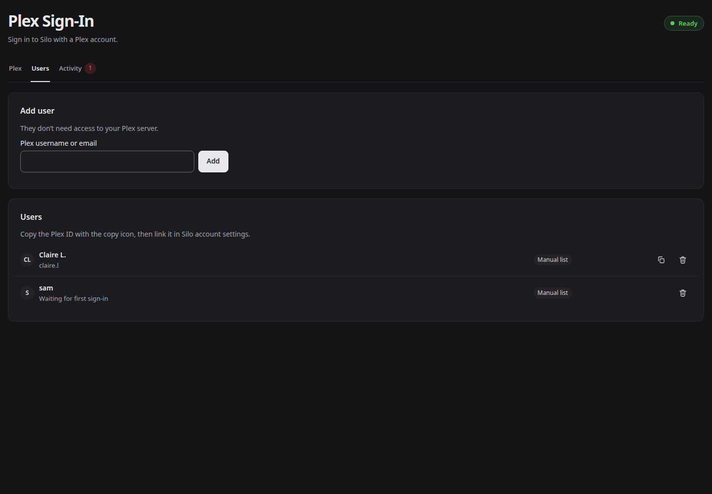

# Plex Sign-In for Silo

Plex Sign-In v0.1.0 is a community Silo plugin that adds a **Plex** button to
the Silo sign-in page. People sign in with their Plex account, and only people
you allow can get in: those who have access to your Plex Media Server, and
those you add to a manual list.

> **Unofficial plugin.** Plex Sign-In is an independent community project. It
> is not a Plex product and is not affiliated with, sponsored, or endorsed by
> Plex, Inc. or by Silo. Plex and the Plex logo are trademarks of Plex, Inc.
> The Plex name and icon are used only to identify the service people sign in
> with. For help with this plugin, use this repository's issues, not Plex or
> Silo support.



## What it does

- Adds a **Plex** login button to Silo (`auth_provider.v1`).
- People approve the sign-in on Plex's own website, so the plugin never sees
  their Plex password.
- After approval, the plugin allows the sign-in only when one of these sources
  matches:
  - **Plex server**: the person has access to the Plex Media Server you
    selected;
  - **Manual list**: the person's Plex username, or confirmed Plex email, is on
    the list you manage.
- Plex Home managed users and guest accounts are always refused.
- Silo creates or links the Silo account; the plugin never assigns Silo roles
  or groups.
- Adds a **Plex Sign-In** page to Silo's administration (`http_routes.v1`) to
  connect the server, manage the manual list and review recent sign-ins.

The plugin only reads from Plex. It never creates shares, sends invitations or
changes Plex settings. The interface is in English.

## Requirements

- A Silo server reachable over **HTTPS**. Sign-in is refused when Silo's
  callback URL is not HTTPS.
- Linux on amd64 or arm64.
- To allow a server's users: the Plex account that owns that Plex Media Server.
  The manual list works without it.

## Installation

Install Plex Sign-In from Silo's plugin administration. Each GitHub release
also provides the `plugin-linux-amd64` and `plugin-linux-arm64` binaries with a
`checksums.txt` file. Templates, styles and the icon are built into the binary;
there is nothing else to install.

## Usage

### Set up access

Open **Plex Sign-In** from Silo's administration navigation. The page has
three tabs.

- **Plex**: choose **Connect Plex**, approve the request on Plex with the
  account that owns your server, then select the server. Everyone who has
  access to that server can now sign in. **Change server** picks another one;
  **Disconnect** forgets the stored Plex connection and keeps the manual list.
- **Users**: add a Plex username or email for someone who does not have access
  to the server. The list shows both sources, and each person's Plex ID once
  they have signed in.
- **Activity**: the latest 100 sign-in decisions, allowed or denied. A denied
  person can be added to the manual list from here with **Add to manual list**,
  without changing Plex sharing.

Sign-in is ready as soon as a server is selected or the manual list has one
entry. Until then, every Plex sign-in is refused.

### Sign in

1. The person chooses **Plex** on the Silo sign-in page.
2. Plex opens and asks them to approve the request.
3. The plugin checks their account against the server and the manual list.
4. If they are allowed, Silo signs them in. If not, the page shows a short
   **sign-in reference** they can send to the administrator, who finds the same
   reference in **Activity**.

### Silo accounts

With Silo auto-provisioning enabled, a first sign-in can create a Silo account
from the Plex username, email and display name. Silo assigns its default group.

To link an existing Silo account instead, copy the person's Plex ID from
**Users** after their first sign-in and use Silo's own account-linking screen.
The plugin cannot see Silo accounts and does not call Silo's administration
API. If the Silo operator enables it, Silo may also match a confirmed Plex
email to an existing account.

### Access re-checks

Silo re-checks existing accounts from time to time. The plugin answers with the
person's Plex account, using the Plex token Silo kept from their sign-in:

- if Plex confirms that the person no longer matches the server or the manual
  list, access is withdrawn and Silo ends their sessions;
- if Plex cannot be reached, or the stored token no longer works, nobody is
  signed out by the plugin; Silo applies its own session limits.

## External services and network access

The plugin makes outbound HTTPS requests to `https://plex.tv` only:

- `POST /api/v2/pins` and `GET /api/v2/pins/<id>`: create and poll the sign-in
  PIN;
- `GET /api/v2/user`: read the signed-in Plex account;
- `GET /api/v2/resources`: check whether the account can reach the selected
  Plex Media Server, and list the owner's servers when connecting;
- `GET /api/v2/home/users` and `GET /api/v2/shared_servers/owned/accepted`:
  list the server owner's Plex Home members and the users who accepted a
  share, for the **Users** tab;
- `GET /api/v2/ping`: Silo's connection test.

The person's browser is sent to `https://app.plex.tv` to approve the request.
The plugin contacts no other service and never connects to a Plex Media Server
directly.

## Data and privacy

- **Sent to Silo at sign-in:** Plex account ID, username, display name, email
  with Plex's confirmation status, avatar URL, and the person's Plex token.
  Silo stores the token as the account's refresh state and sends it back for
  re-checks; the plugin itself does not keep it.
- **Stored by the plugin in Silo instance state:** the manual list, the
  selected server, the server owner's Plex token, and the activity log. Silo
  is responsible for protecting its instance state.
- **Activity log:** at most 100 decisions, with the Plex account ID and limited
  display fields; anonymous failures are capped separately.
- **Owner token:** used to read server-access information. **Disconnect**
  forgets it in the plugin; signing out of Silo does not revoke Plex tokens.
- **Pending sign-ins** are kept in memory for up to 10 minutes. A plugin
  restart can require the person to start again.
- Sign-in uses Plex's PIN approval, not OpenID Connect. Keep plugin and OAuth
  callback URLs out of access logs and diagnostic captures: they carry
  short-lived sign-in values.
- Like any PIN-based sign-in, a sign-in link can be sent to someone else. If
  they approve it on Plex, the sender's browser is signed in to Silo as them.
  The plugin only lets the browser that opened the link finish the sign-in,
  and links expire after 10 minutes; tell your users to approve only Plex
  requests they started themselves.
- The server rule trusts what Plex reports for each account. A server the
  account owns only counts for the Plex account that connected it, so another
  person cannot get in by running a server with the same identifier.

Operators should provide their own retention and privacy information suited to
their deployment.

## Screenshots

The screenshots in [`docs/screenshots`](docs/screenshots/README.md) use
synthetic test data only: no real Plex identities, email addresses, tokens,
PINs or server URLs. They show the plugin's pages, not Plex's website.

## Development

Requires Go 1.26.11 or newer. No frontend build step is needed.

```sh
gofmt -l .
go vet ./...
go test -race -count=1 ./...
go run . manifest       # print the manifest with its HTTP routes
make check-version      # manifest.json, provider.Version and README agree
make build build-arm64  # dist/plugin-linux-amd64, dist/plugin-linux-arm64
```

Tests use local fake servers; they never contact plex.tv or a real Silo.

## Releases

Releases are built, signed and published by Silo's shared plugin release
workflow ([`.github/workflows/release.yml`](.github/workflows/release.yml)):

1. Merge a change that sets the new `version` in `manifest.json` and
   `provider.Version`.
2. Push the matching `v<version>` tag on `main`.

The workflow requires each release to raise the version and attaches the
binaries, `checksums.txt` and a signed provenance bundle to the GitHub release.

## Security

Report vulnerabilities privately; see [`SECURITY.md`](SECURITY.md).

## Support

Use this repository's
[issues](https://github.com/buzzromain/silo-plugin-auth-plex/issues) for
questions and bug reports about the plugin.

## License

Copyright (C) 2026 buzzromain

Plex Sign-In is free software: you can redistribute it and/or modify it under
the terms of the GNU Affero General Public License as published by the Free
Software Foundation, either version 3 of the License, or (at your option) any
later version. It is distributed WITHOUT ANY WARRANTY; see [`LICENSE`](LICENSE)
for details. Third-party dependencies keep their own licenses.
